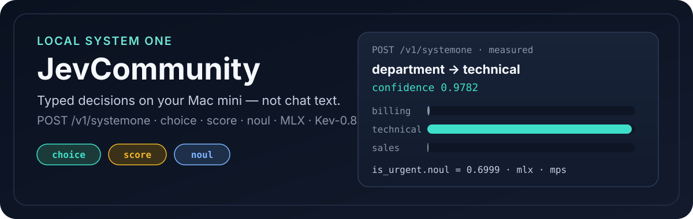
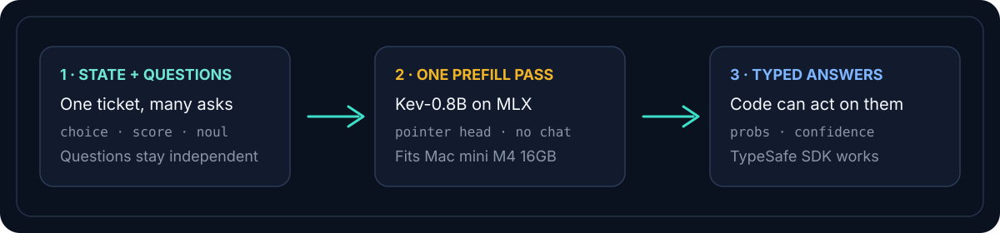

<p align="center">
  
</p>

# JevCommunity

**Local Jev-compatible decisions for software — on a Mac mini M4.**

Send one shared `state` and parallel typed questions (`choice` / `score` / `noul`). Get probability distributions and confidence back. No chat generation.

<p align="center">
  <a href="#quick-start"></a>
  
  
  
</p>

## Why it exists

TypeSafe **Jev** is a hosted System One decision model: great for production APIs, not something you can self-host. **JevCommunity** vendors the open [Kev](https://github.com/jaredpalmer/kev) serve stack and pins **Kev-0.8B** so the same `/v1/systemone` shape runs locally on **16 GB Apple Silicon**.

| You want… | Use |
| --- | --- |
| Hosted frontier accuracy | TypeSafe Jev |
| Local Mac prototyping / offline API parity | **JevCommunity (this repo)** |

Quality tracks **Kev-0.8B**, not proprietary Jev. Kev’s cards put Jev near Decision Index ~54; 0.8B is much lower. Use this for schema/confidence parity and local iteration.

## Proof (real local run)

Ticket about API 500s → routing decision on `127.0.0.1:8008` with MLX:

| Field | Result |
| --- | --- |
| `answers.department.choice` | `technical` |
| `answers.department.confidence` | `0.9782` |
| `answers.department.probabilities` | billing `0.0099` · technical `0.9854` · sales `0.0046` |
| `answers.is_urgent.noul` | `0.6999` |
| Backend | `mlx` / `mps` |

## How it works

<p align="center">
  
</p>

1. **Ask** — `POST /v1/systemone` with `state` + named questions.
2. **Score** — Kev-0.8B pointer head returns option probabilities (no text generation).
3. **Act** — your code thresholds `confidence` / `noul` like production Jev clients.

Accepted `model` names: `kev-latest`, `jev-latest`, `jevcommunity-0.8b`.

## Quick start

**Needs:** macOS arm64, [uv](https://docs.astral.sh/uv/), Python 3.13, Hugging Face network on first download (~few GB for adapter + `Qwen/Qwen3.5-0.8B-Base`).

```bash
./scripts/serve_mac.sh
```

That syncs deps and serves:

```bash
uv run --extra serve python -m kev.serve \
  --run jaredpalmer/kev-0.8b@v1.0 \
  --host 127.0.0.1 --port 8008 --device auto
```

Leave `KEV_BACKEND` unset (auto → MLX on Darwin). Optional `KEV_API_KEY` enables bearer auth.

### First request

```bash
curl -sS http://127.0.0.1:8008/v1/systemone \
  -H 'content-type: application/json' \
  -d '{
    "state": "Our API integration started returning 500 errors on every request about 20 minutes ago, and we cannot process any customer orders until this is fixed.",
    "model": "jev-latest",
    "questions": {
      "department": {
        "type": "choice",
        "instructions": "Which team should handle this",
        "criteria": {
          "billing": "Payment or subscription issues",
          "technical": "Bugs or integration problems",
          "sales": "Pricing or account questions"
        }
      },
      "frustration": {
        "type": "score",
        "instructions": "How frustrated the customer appears",
        "criteria": [
          "Calm, just stating facts",
          "Frustrated but civil",
          "Very angry, strong language"
        ]
      },
      "is_urgent": {
        "type": "noul",
        "instructions": "The message conveys urgency or time-sensitivity"
      }
    }
  }'
```

Or via TypeSafe SDK:

```bash
uv run --extra serve python examples/route_ticket.py
```

### Tests

```bash
JECOMMUNITY_BASE_URL=http://127.0.0.1:8008 uv run pytest -m server tests/test_systemone_smoke.py -q
```

## Limits (read before upgrading models)

- **Text primitives only** in this setup: `choice`, `score`, `noul`. No Box/images.
- **Hardware:** Kev documents 0.8B for any Apple Silicon Mac; **4B targets ~32 GB**. Stay on 0.8B for 16 GB.
- **Fallback:** if MLX fails, `KEV_BACKEND=torch … --device cpu`. If that OOMs, stop — don’t jump to 4B/9B without quantization.
- **Not affiliated** with TypeSafe AI. “Jev” compatibility means API/schema/confidence formulas, not identical accuracy.

## Provenance & license

- **This repo:** MIT — see [`LICENSE`](./LICENSE). Funding: GitHub Sponsors [`syrex1013`](https://github.com/sponsors/syrex1013).
- **Serve stack:** vendored from Jared Palmer’s [Kev](https://github.com/jaredpalmer/kev) @ `2074cc4` (Apache-2.0) — [`NOTICE`](./NOTICE), [`third_party/kev/LICENSE`](./third_party/kev/LICENSE).
- **Weights:** `jaredpalmer/kev-0.8b@v1.0` (rev `9a45d25e`) on `Qwen/Qwen3.5-0.8B-Base` (rev `dc7cdfe2`).
